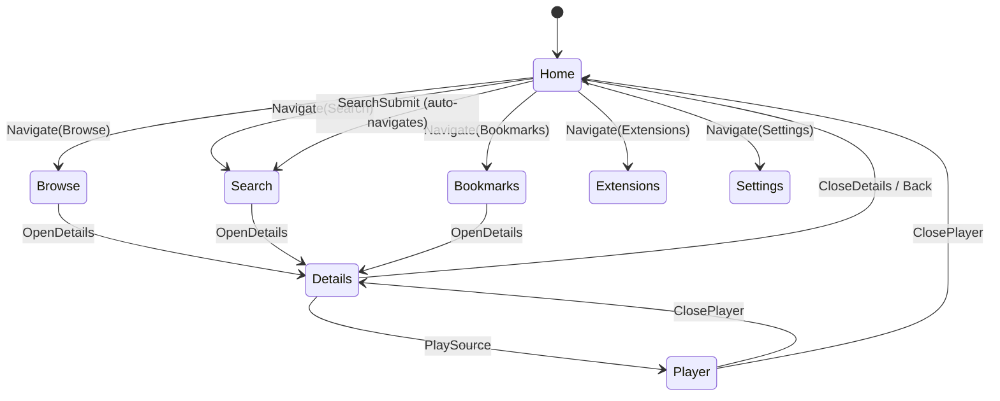

# Architecture — CloudStream Desktop (Rust engine, Windows)

This document is the implementation reference for `desktop-rust/`: a Windows
media centre with a Rust core, a native immediate-mode UI, sandboxed WebAssembly
providers and an Inno Setup installer.

It contains no content and no bundled providers. What a user can watch comes
entirely from extensions they install.

---

## 0. Scope, and one honest boundary

The requested *product* description mentions Android phones, Android TV and
Chromecast. **This Rust codebase is Windows-only and does not replace those
targets.** They remain covered by the existing Kotlin application in this
repository (`app/`, `library/`, `shared/`, `desktopApp/`), which already builds
for phone, TV and Cast.

What is shared between the two is the *idea*, not the code:

| Concern | Kotlin app (Android/TV) | This crate tree (Windows) |
|---|---|---|
| Extension format | JVM `.jar`, in-process | WebAssembly, sandboxed |
| Playback | ExoPlayer / Media3 | libmpv via `mpv_render_context` |
| Distribution | APK | Inno Setup `.exe` |
| Repository index | JSON | JSON (a compatible shape, see `PLUGIN_ABI.md`) |

If Cast support is wanted on Windows later, that is a separate crate behind the
`PlaybackEngine` port (§4) plus a device-discovery service — the architecture
leaves room for it, but nothing here pretends to implement it.

---

## 1. Crate graph

```
                    ┌──────────────┐
                    │   app (bin)  │  wiring, threads, CLI, self-test
                    └──────┬───────┘
        ┌──────────────────┼──────────────────┬─────────────────┐
        │                  │                  │                 │
   ┌────▼─────┐      ┌─────▼──────┐     ┌─────▼──────┐    ┌─────▼──────┐
   │ app-ui   │      │app-playback│     │app-plugin- │    │app-storage │
   │ (egui)   │      │  (libmpv)  │     │   host     │    │(json+DPAPI)│
   └────┬─────┘      └─────┬──────┘     └─────┬──────┘    └─────┬──────┘
        │                  │                  │                 │
        └──────────────────┴────────┬─────────┴─────────────────┘
                                    │
                              ┌─────▼──────┐        ┌───────────┐
                              │  app-core  │◀───────│  app-net  │
                              │ (pure)     │        │  (ureq)   │
                              └────────────┘        └───────────┘
```

`app-core` depends on `serde` and nothing else. No GUI, no HTTP, no platform
code, no I/O. That is what makes the whole state machine unit-testable, and it is
also what keeps the binary from dragging in an async runtime.

**Dependency direction is enforced by the crate graph, not by discipline.** A
view physically cannot reach a provider or a decoder: `app-ui` does not depend on
`app-plugin-host` or `app-playback`.

---

## 2. State management (MVI)

Three types define the whole loop:

```rust
pub struct AppState { /* one struct, all screens */ }
pub enum Intent { /* everything that can happen */ }
pub enum Effect { /* everything the reducer wants done */ }
```

```
        ┌──────────────┐   Intent    ┌───────────────┐   Effect    ┌─────────────┐
        │   app-ui     │────────────▶│    reducer    │────────────▶│   runtime   │
        │ (draw only)  │             │ (&mut state)  │             │ (threads)   │
        └──────▲───────┘             └───────┬───────┘             └──────┬──────┘
               │                             │                            │
               │         AppState (read)     │                            │
               └─────────────────────────────┘                            │
                                                                          │
                          Intent::HomeLoaded / SearchResults /           │
                          DetailsLoaded / PlaybackEvent / …  ◀───────────┘
```

Rules, all of them load-bearing:

1. **The reducer is the only writer.** `reduce(&mut AppState, Intent) -> Vec<Effect>`.
2. **Intents cover async results too**, so a background job cannot mutate state
   directly — it posts an intent like everyone else.
3. **Effects are requests, not actions.** `Effect::Search { .. }` does not search;
   the runtime does, then posts `Intent::SearchResults`.
4. **No handles in state.** State holds values (titles, URLs, phases), never a
   decoder, socket or provider.

### 2.1 Screen/navigation state machine



`Details` and `Player` are overlays, not routes: the route underneath survives, so
closing the player returns the user exactly where they were.

### 2.2 Playback lifecycle

```mermaid
stateDiagram-v2
    [*] --> Idle
    Idle --> Loading: PlaySource → Effect::PlayerLoad
    Loading --> Playing: PlaybackEvent::Loaded
    Loading --> Failed: PlaybackEvent::Failed
    Playing --> Paused: Paused(true)
    Paused --> Playing: Paused(false)
    Playing --> Ended: Ended
    Paused --> Ended: Ended
    Playing --> Loading: PlaySource (new source)
    Paused --> Loading: PlaySource (new source)
    Ended --> Loading: PlaySource
    Failed --> Loading: PlaySource
    Loading --> Idle: ClosePlayer
    Playing --> Idle: ClosePlayer
    Paused --> Idle: ClosePlayer
    Ended --> Idle: ClosePlayer
    Failed --> Idle: ClosePlayer
```

Resume handling lives in one place (`resume_position`): a stored position is used
unless playback had already passed 95 % of the runtime, in which case the item
starts over instead of resuming into the credits.

### 2.3 Search fan-out

```
SearchSubmit ──▶ reducer: pending = [enabled providers with search capability]
              └─ Effect::Search { query, provider_ids }

runtime: one job per provider on its own worker
          ↓ (as fast as each provider answers)
        Intent::SearchResults { provider_id, query, items }
          ↓
reducer: if query != active_query → DROP   (stale reply from an old query)
         else merge with de-duplication by (provider_id, id)
```

Results stream in; the grid fills progressively instead of waiting for the
slowest extension. `pending` drives the spinner and empties as replies land.

---

## 3. Threading model

Four kinds of threads, all owned by the runtime in `crates/app`:

| Thread | Count | Responsibility |
|---|---|---|
| UI thread | 1 | egui frame, GL compositing, reducer calls |
| Work thread | 1 | consumes `Effect`s: repository fetch, install, detail/resolve |
| Provider fan-out | 1 per in-flight search | parallel provider calls (each WASM plugin is serialised internally) |
| mpv event thread | 1 | `mpv_wait_event` loop → `PlaybackEvent` over a channel |
| Cover worker | 1 | downloads poster bytes to the cache directory |

The UI never blocks: it drains a result channel at the top of each frame and
`request_repaint_after` keeps a slow tick while work is in flight.

The playback engine sits behind `Arc<Mutex<Box<dyn PlaybackEngine>>>`: the runtime
sends transport commands, the UI thread renders frames. Only the client handle is
touched from two threads; the render context stays on the UI thread, which is what
libmpv's render API requires.

---

## 4. Ports (the seams)

Everything external is a trait in `app-core::ports`:

```rust
pub trait Provider: Send + Sync {
    fn manifest(&self) -> ProviderManifest;
    fn home(&self) -> Result<Vec<HomeRow>, ProviderError> { … }
    fn search(&self, query: &str) -> Result<Vec<MediaItem>, ProviderError> { … }
    fn details(&self, id: &str) -> Result<MediaDetails, ProviderError> { … }
    fn resolve(&self, id: &str, o: &ResolveOptions) -> Result<Vec<StreamSource>, ProviderError> { … }
}

pub trait Extractor: Send + Sync {
    fn name(&self) -> &str;
    fn supports(&self, url: &str) -> bool;
    fn extract(&self, url: &str, ctx: &ExtractContext) -> Result<Vec<StreamSource>, ProviderError>;
}

pub trait RepositorySource: Send + Sync {
    fn id(&self) -> &str;
    fn url(&self) -> &str;
    fn fetch(&self) -> Result<Repository, ProviderError>;
    fn fetch_binary(&self, url: &str) -> Result<Vec<u8>, ProviderError>;
}

pub trait PlaybackEngine: Send {
    fn kind(&self) -> EngineKind;
    fn load(&mut self, request: PlaybackRequest) -> Result<(), PlaybackError>;
    fn command(&mut self, command: PlaybackCommand) -> Result<(), PlaybackError>;
    fn poll(&mut self) -> Vec<PlaybackEvent>;
    fn needs_render(&self) -> bool;
    fn render(&mut self, target: RenderTarget) -> Result<(), PlaybackError>;
    fn shutdown(&mut self);
}

pub trait HttpClient: Send + Sync {
    fn execute(&self, request: HttpRequest) -> Result<HttpResponse, ProviderError>;
}
```

Two deliberately *un*-abstracted things: storage (a concrete `Store`, because
there is exactly one file format) and the WASM runtime (extism, because swapping
it is a research project, not a config change).

`RenderTarget` is the important one for video: the UI hands the engine the
framebuffer it is currently drawing into, so the decoder composites in the same
pass as the interface. No child window, no z-order fights, no tearing on resize.

---

## 5. Adaptive layout

Computed in `app-core::layout` as a pure function, unit-tested at the boundaries:

| Logical width | Breakpoint | Navigation | Card min width | Columns |
|---|---|---|---|---|
| < 720 px | Compact | bottom bar (56 px) | 132 px | 1–3 |
| 720–1200 px | Medium | icon rail (68 px) | 148 px | 3–5 |
| > 1200 px | Expanded | labelled rail (208 px) | 168 px | 5–8 |

Rules:

* Sizes are **logical points**; the windowing layer applies the DPI scale. The
  same 1600×900 window at 150 % yields the same column count as at 100 %
  (asserted in a test), which is the bug that usually appears when physical
  pixels leak into layout maths.
* Column count is solved from available width and a per-breakpoint minimum, then
  cards are stretched to fill the row exactly, so there is never a ragged gap
  or an overflowing row (also asserted, 420 px → 3840 px).
* Video aspect is *not* computed in layout. `AspectMode` maps to mpv's
  `panscan`/`keepaspect`/`video-unscaled`, because the decoder knows the real
  frame geometry and the UI does not.

---

## 6. Security and trust model

```
repository index (JSON)  ──▶ Ed25519 signature (optional but verified if present)
        │
        ├──▶ each extension: mandatory SHA-256
        │            │
        │            ▼
        │       download → verify hash → only then write to disk
        │
        ▼
   WebAssembly guest, instantiated per provider:
     imports:  host_http_request, host_log      (nothing else)
     limits:   64 pages memory (4 MiB), 30 s call timeout
     denials:  no filesystem, no process, no raw sockets, no clock tricks
```

* An index **without** a signature is accepted (that is how community
  repositories work in practice) but the hash still pins every binary, so a
  compromised index cannot silently swap a payload.
* An index **with** a signature must verify, or the whole repository is refused.
* The host HTTP function only accepts `http`/`https` and caps response bodies at
  8 MiB.
* Provider ids are validated (`[A-Za-z0-9._-]{1,128}`) and file paths are
  sanitised, so an id cannot escape the extensions directory.

Known gap, stated plainly: private/loopback addresses are not blocked, so a
malicious plugin could probe the user's LAN. Closing that needs IP-range checks
after DNS resolution; it is not implemented here.

---

## 7. Size budget

Target: installer under 25 MB, ideally under 15 MB.

Measured with `cargo build --release -p app` (`opt-level = "z"`, fat LTO,
`codegen-units = 1`, stripped): **`cloudstream-desktop.exe` = 11.39 MiB**
(11,941,376 bytes). The full chain (`scripts/build.ps1`, Inno Setup 6.7.3) produces
`installer/Output/CloudStreamDesktop-0.1.0-setup.exe` at **5.88 MiB**
(6,162,592 bytes) — 48 % smaller than its payload.

| Component | Contribution |
|---|---|
| Rust binary (egui + egui_glow + wasmtime + ureq + rustls) | **11.39 MiB**, measured |
| `libmpv-2.dll` + FFmpeg (shared, optional) | 0 if user-supplied, ~25–35 MB if bundled (estimate) |
| SQLite | 0 — not used |
| WebView2 | 0 — not used |
| Installer (LZMA2 solid) | **5.88 MiB total**, measured |

**The target is met only in the "bring your own libmpv" configuration.**
Shipping libmpv adds ~25–35 MB. That is a deliberate, documented trade-off, not an
oversight: see `DEPENDENCIES.md`. UPX is never used (it triggers antivirus
heuristics); signing is the mitigation instead.

---

## 8. Build and release

```
scripts/build.ps1
  1. read version from Cargo.toml
  2. cargo build --release --target x86_64-pc-windows-msvc
  3. stage dist/: exe, optional libmpv-2.dll, LICENSE, notices
  4. dumpbin /dependents check (fails the build on an unexpected import)
  5. ISCC.exe installer/installer.iss /DAppVersion=…
  6. optional signtool
```

CI (`.github/workflows/desktop-rust.yml`) runs `cargo fmt --check`,
`cargo clippy -- -D warnings` and `cargo test` on every push that touches
`desktop-rust/`, and builds the installer on version tags.

---

## 9. What is implemented vs. what is scaffolding

Implemented and covered by tests (59 unit tests at time of writing):

* domain model, MVI reducer, all navigation/playback/bookmark transitions;
* layout maths incl. DPI and grid overflow;
* settings/bookmarks/progress/repository/extension persistence, atomic writes,
  DPAPI protect/unprotect round-trip;
* repository parsing, validation, Ed25519 verification, hash-checked install;
* provider registry incl. failing-extension isolation;
* WASM provider host functions and envelope error mapping;
* libmpv FFI (loads dynamically; falls back cleanly), null engine timeline;
* adaptive UI across three breakpoints with a custom vector icon set.

Scaffolding or unverified at runtime:

* **Video compositing** (offscreen FBO → blit) compiles but was never executed
  against a real `libmpv-2.dll` in this environment.
* **Cast/AirPlay** — not implemented (see §0).
* **LRU eviction** of the cover cache — the size is measured and shown; eviction
  is not yet wired to the limit.
* **Extractor trait** is defined and wired into the domain, but no first-party
  extractor ships (correctly: extractors are content-specific).
